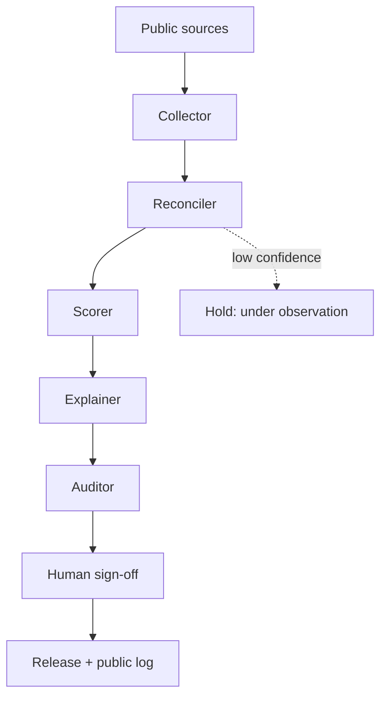

# ABoringBot

A set of AI agents that collect public football data, confirm every key number on two independent sources, score players with a fixed method written down before ranking, and write a sourced justification for each pick.

Scope: lower leagues, Serie D / Lega Pro and below, where data is thin and few people check it.

## Why "boring"

- **Boring as in drilling.** Digging where few people look: lower-league fixtures, match reports, federation releases, local press.
- **Boring as in unglamorous.** Most of the work is verification: matching minutes across sources, resolving conflicts, logging what was checked. The system is built to do that work every time, not to be interesting.

Agents replace hand-maintained scraping scripts. Agents collect and check data; a fixed, pre-registered method decides.

## Principles

1. **Public sources only.** Every number must be traceable to a public page: league releases, match reports, club sites, local press, public databases.
2. **Two-source rule.** Key figures (minutes, goals, assists) must be confirmed by two independent sources. Conflicts are resolved with a rule set in advance: small gaps take the lower value at reduced confidence; larger gaps exclude the figure until an official match report settles it.
3. **Method frozen before ranking.** Weights, gates and parameters are written and dated before any ranking is computed. Any change creates a new dated version and applies only to later picks.
4. **Every pick logged and graded, misses included.** Picks are frozen in a public log with date, method version, score, inputs and sources. Entries are never edited; corrections are appended. Results at each checkpoint are published, failures included, against a naive baseline.
5. **A human signs before anything ships.** No output is published without review and sign-off by the owner.

## Live now: the Radar

The first output produced under these rules is the monthly Radar.

- Italian: https://www.matchanalysispro.online/radar/
- English: https://www.matchanalysispro.online/en/radar/

**Release 01**, 18 Oct 2026: 10 under-23 picks from Serie D, girone D. Data was collected and reconciled with heavy manual supervision. The Collector and Reconciler below now run, but do not yet reproduce it on their own (see Status).

### Method v1.0 (fixed 18 Oct 2026, before the first release)

**Gates** (all required):

- born 2003 or later;
- at least 35% of available minutes (team matches x 90);
- key figures confirmed by two sources (minutes for all roles; plus goals and assists for forwards; plus assists for full-backs).

**Weights** (composite score 0-100):

| Component | Weight | Definition |
|---|---|---|
| Role output | 0.45 | role-specific, see below |
| Minutes share | 0.25 | minutes / available minutes |
| Age vs under quota | 0.15 | 1.0 for born 2003-2005, 0.6 for 2006-2008 (players a team must field under the under rule) |
| Team position | 0.15 | (19 - league position) / 18 |

**Role output** (per-90 values shrunk toward a declared role mean with a 270-minute prior):

- FW: (G+A)/90.
- MID: mean of percentiles of (G+A)/90 and starts share.
- FB/WB: 0.6 x percentile of A/90 + 0.4 x percentile of starts share.
- CB: 0.5 x percentile of starts share + 0.5 x percentile of team goals conceded per match (inverted). This is a team figure, not on-pitch goals against, which is not public. Stated as a known limitation.

**Percentiles within role.** Each component becomes a percentile among eligible players of the same role group. Scores compare a player with his group, not across roles. Small groups make percentiles coarse.

**Role quotas** for the 10 picks: 2 CB, 2 FB, 3 MID, 3 FW. Unfilled slots go to the best remaining eligible players and are declared in the release. Ties: higher minutes share, then alphabetical.

**Validation checkpoints** (pre-registered): ~24 Nov 2026 (after 6 rounds), ~31 Jan 2027 (after 15 rounds), 3 May 2027 (end of season). A pick counts as a success if at season end it keeps its minutes share (-10 pp tolerance) and has role output above the group median, or moves up a level or is called up to a representative or youth national team. The success rate is published over all picks, compared against a naive baseline: the three under players with the most minutes in the group.

**Justification template**: three lines per pick, each with a number and a source: usage, output, context.

## Building: agent pipeline



| Agent | Role |
|---|---|
| Collector | Fetches fixtures, match reports, appearances and standings from public sources; stores raw pages per source with URL and retrieval time. |
| Reconciler | Matches player identities across sources, compares fields, applies the pre-set conflict rule, assigns confidence, logs every conflict. |
| Scorer | Runs the frozen method version on reconciled data. No discretion: same input, same output. |
| Explainer | Writes the three-line justification for each pick, each line citing a number and its source. |
| Auditor | Re-checks every cited number against its source, checks gates and quotas, flags anything that does not trace back. |

Agents do not change weights, gates or quotas. Method changes are made by a human, dated, and versioned.

## Status (19 Oct 2026)

**Working (deterministic Python, no LLM, no paid servers; runs on one machine):**

- **Collector** (`aboringbot/collector/`), Serie D girone D:
  - Transfermarkt: fixtures, every match report up to a cutoff round (starters, substitutions, red cards, goals, assists), squad lists (date of birth, main position), profiles of players no longer in a squad.
  - SofaScore: rounds, lineups, incidents (substitution and red-card minutes), dates of birth. Independent of Transfermarkt. Fetched through headless Chrome because its public JSON is only served to browsers.
  - Raw pages cached under `data/raw/<date>/<source>/` with an `index.jsonl` (URL, UTC retrieval time, HTTP status). robots.txt checked, 3 s / 2 s between requests.
  - Minutes use one convention for both sources (nominal minute, 90' per match, added-time substitute = 1').
- **Reconciler** (`aboringbot/reconciler/`): club matching by name, match alignment by round + teams, player matching by normalized name + date of birth within club, standings / matches played / goals conceded computed from results at the cutoff, conflict rule of method v1.0 sec. 1 applied as written (`rules.py`), audit log of every conflict with per-match differences, identity log, optional manual third-source file (`data/manual/evidence.csv`, match reports read by a human) that can raise confidence to "alta".
- **Output**: `data/out/<date>/round<NN>/reconciled.csv`, same schema as the Release 01 file; `score.py` runs on it unchanged. Club exclusions stay in a git-ignored local config (`config/local.example.toml`).
- **Acceptance test** (`aboringbot cli accept`): diff against the manually reconciled Release 01 file, per-field match rate, every mismatch with its cause, picks and scores compared. Summary: [docs/acceptance_release01.md](docs/acceptance_release01.md).

**Result of the acceptance test (cutoff: round 7, 40 Release 01 players):** identity matching 40/40; birth year, club, standings, matches played, goals conceded, appearances, starts and goals 100%; minutes 72%; assists 85%. The 10 picks are **not** reproduced under the strict rule: SofaScore published no lineups for 5 of 62 matches, so 26 of 40 players have part of their minutes from one source only and fall to "bassa". With confidence measured on the matches both sources cover (diagnostic, not the method), 8 of 10 picks coincide.

**Not working yet / still manual:**

- zerozero/soccerzz, Calciotel, tuttocampo, I AM CALCIO and seried.it block automated access from this machine; they are not collected.
- "alta" confidence needs an official match report or club/press report: no automated parser yet; a human enters them in `data/manual/evidence.csv`.
- Club-link exclusions (ownership, loans, youth sector) need a human profile check.
- Scorer, Explainer, Auditor are not agents yet: `score.py` (method v1.0) is run by hand.

### Run

```bash
pip install -r requirements.txt          # needs system Chrome for SofaScore
cp config/local.example.toml config/local.toml   # fill exclusion lists
python -m aboringbot.cli run --max-round 7
python -m aboringbot.cli accept --max-round 7 --reference REF.csv --score score.py --release release_01.json
python -m pytest -q tests
```

Fresh run: about 7-15 minutes (Transfermarkt answers slowly; ~100 pages). Re-runs on the same day use the cache: about 15 s. Reconciliation: under 1 s.

Old Cloudflare Worker scaffold: moved to `legacy/`, not used.

## Owner

Mirko Tornani, San Marino. Former youth coach (15 years), UEFA B and C licences, scout.

## License

License: TBD
